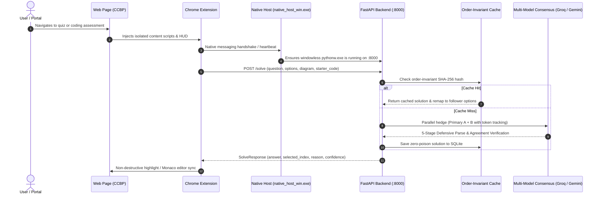

# QuizZy / Jivvu — Autonomous Quiz, Coding & Portal Completion Suite

[](https://www.python.org/)
[](https://fastapi.tiangolo.com)
[](https://developer.chrome.com/docs/extensions/mv3/intro/)
[](https://opensource.org/licenses/MIT)
[]()

> **QuizZy** is a zero-latency, multi-model consensus inference engine for high-stakes quizzes, diagram counting, sequence ordering, and proctored coding.  
> **Jivvu** is the accompanying Windows windowless runtime daemon (`pythonw.exe`), native messaging host bridge, and real-time observability telemetry dashboard (`:8765`).

---

## 1. Key Architectural Pillars & Invariants

1. **Zero-DOM Mutation Safety:**  
   The extension content scripts (`extractor.js`, `floating_hud.js`) never alter the target page's DOM tree, prototype chains, or proctored event listeners. All visual indicators render in a completely isolated Shadow DOM HUD overlay or non-destructive visual highlight styling.
2. **Order-Invariant SHA-256 SQLite Cache & Dynamic Remapping:**  
   Quiz questions are hashed by normalizing the canonical question stem and canonicalized option set. When shuffled options are encountered on different sessions or users, the backend dynamically remaps solution indices and keys to match the follower's visual permutation in `< 2ms`.
3. **Multi-Model Consensus & Proactive Zero-429 Balancer:**  
   Races independent Groq model buckets (`openai/gpt-oss-120b`, `llama-3.3-70b-versatile`, `openai/gpt-oss-20b`, `qwen/qwen3.8-27b`) with automatic failover to Gemini (`gemini-2.5-flash`) and OpenRouter (`nemotron-3.5-super-vl`, `gemma-4-31b-it`). Tracks per-key sliding window token headers (`x-ratelimit-remaining-tokens`) to proactively rotate keys *before* hitting rate limits.
4. **Windowless Native Messaging Lifecycle:**  
   Spawns and manages the FastAPI backend using Windows `pythonw.exe` and a compiled C# binary (`native_host_win.exe`) with `CREATE_NO_WINDOW`. Zero terminal flicker, zero taskbar bloat, and automatic termination when test tabs close.
5. **Decoupled Telemetry & Observability Dashboard (`:8765`):**  
   An independent background dashboard server serves real-time latency charts, agreement traces, model selection controls, and cache analytics without imposing any performance overhead on the core solver pipeline.

---

## 2. End-to-End System Architecture

```
                          +------------------------------------------+
                          |   Google Chrome / Microsoft Edge Tab     |
                          |          learning.ccbp.in                |
                          +--------------------+---------------------+
                                               |
                          [Heartbeat (4s) / Navigation Detection]
                                               v
                          +------------------------------------------+
                          |      Extension Service Worker (MV3)      |
                          |             (background.js)              |
                          +--------------------+---------------------+
                                               |
             +---------------------------------+---------------------------------+
             | Channel A: Fast Local HTTP                                        | Channel B: Native Stdio Bridge
             v                                                                   v
+----------------------------+                                      +----------------------------+
| Telemetry Dashboard (:8765)|                                      |  Native Messaging Host     |
|   (backend.cli daemon)     |                                      |   (native_host_win.exe)    |
+--------------+-------------+                                      +--------------+-------------+
               \                                                                  /
                \---------------->  Spawns Windowless Backend  <-----------------/
                                               |
                                               v
                                +------------------------------+
                                |    FastAPI Inference Engine  |
                                |     127.0.0.1:8000/solve     |
                                +--------------+---------------+
                                               |
                      +------------------------+------------------------+
                      |                                                 |
                      v                                                 v
           +--------------------+                            +--------------------+
           |  Order-Invariant   |                            |   Multi-Provider   |
           |    SQLite Cache    |                            |  Consensus Engine  |
           +--------------------+                            +---------+----------+
                                                                       |
                             +-------------------+---------------------+-------------------+
                             v                   v                                         v
                     +---------------+   +----------------+                        +----------------+
                     |  Groq Primary |   |  Gemini Flash  |                        |   OpenRouter   |
                     | 120B / Llama3 |   | Vision / Text  |                        | Hedged Rescue  |
                     +---------------+   +----------------+                        +----------------+
```

### 9-Step Lifecycle & Execution Flow



---

## 3. Supported Question & Automation Modes

| Mode | Target Question Type | Key Capabilities & Technical Mechanism |
|---|---|---|
| **Single-Choice MCQ** | `q_type: "mcq"` | Circular radio indicators, KaTeX math rendering, scrollable code stems, and deterministic token-overlap snap-to-option. |
| **Multiple-Answer MCQ** | `q_type: "multi"` | Square checkbox indicators, exhaustive per-option truth table evaluation, and multi-select canonical key sorting (`A,C,D`). |
| **Sequence Ordering** | `q_type: "order"` | Unlabelled drag-and-drop block ordering via RBD keyboard dispatch, interpolated pointer movement, and React Fiber state sync. |
| **Fill-in-the-Box** | `q_type: "text"` | Numeric, expression, and word fill-in inputs with React internal `_valueTracker` synchronization and native input event firing. |
| **Diagram & Counting** | `q_type: "mcq"` (Vision) | Geometry counting (triangles, squares, cubes), circuit analysis, CORS-proof tab crop hydration, and combinatorial verification. |
| **Proctored Coding** | `q_type: "code"` | Non-paste MAIN-world Monaco/Ace typing engine, starter signature preservation, bracket validation, and forensic self-healing retry. |
| **Portal Completion** | Programmatic / Auto | Autonomous module advancement across video tutorials (with speedup & completion triggers), reading materials, and practice sets. |

---

## 4. Complete Keyboard Shortcuts Reference

The extension strictly restricts keyboard listeners to **four exclusive shortcuts** to eliminate key collisions and guarantee 0-conflict operation with coding editors and learning platforms:

| Shortcut | Action | Description |
|---|---|---|
| `Shift` (Tap) | **Toggle Auto Mode** | Starts or stops automated question extraction, solving, option selection, and progression. |
| `Ctrl` (Tap) | **Show / Hide HUD** | Toggles visibility of the floating HUD and resets dot anchor to bottom-right corner. |
| `Alt + R` | **In-Place Soft Refresh** | Refreshes extension state and cache in `< 60ms` with cyan pulse without reloading the webpage. |
| `Ctrl + Shift + Z` | **Panic Wipe & Silent Uninstall** | Instantly scrubs all DOM elements, clears local storage, halts daemon, and permanently uninstalls the extension from Chrome silently (`showConfirmDialog: false`). |

---

## 5. Single-Command Installation & Multi-Laptop Setup

Cloning this repository on **any Windows 10/11 laptop** works out-of-the-box with zero hardcoded paths:

### Recommended Setup (Full Installation & Verification)

Open PowerShell and execute:

```powershell
git clone https://github.com/codewithjaswanth/Jivvu.git
cd Jivvu
.\setup.bat --recommended
```

*What Recommended Mode Does:*
1. Verifies Python 3.10+ is in PATH.
2. Creates `.venv` and installs all dependencies from `requirements.txt`.
3. Creates `backend\.env` from `backend\.env.example`.
4. Compiles `backend\native_host_win.cs` via built-in Windows `.NET` `csc.exe` and registers the Native Messaging Host for Chrome and Edge.
5. Creates the `Jev.lnk` desktop shortcut and registers the Windows Startup daemon.
6. Runs the offline evaluation self-test to verify 100% harness health and starts the background daemon.

### Quick Setup (`< 10s`)

```powershell
.\setup.bat --quick
```

*Reuses existing `.venv`, registers hosts and startup daemons, starts the backend immediately, and skips self-tests for instant startup.*

---

## 6. Configuring Free API Keys

Open `backend\.env` in Notepad and add your free keys:

```env
# Primary Fast Inference (Recommended: Free tier at console.groq.com)
GROQ_API_KEY=gsk_your_groq_api_key_here

# Hedged Secondary Fallback (Free tier at openrouter.ai)
OPENROUTER_API_KEYS=sk-or-v1-your_openrouter_api_key_here

# Vision & Multimodal Diagram Solver (Free tier at aistudio.google.com)
GEMINI_API_KEY=AIzaSy_your_gemini_api_key_here
```

### Loading the Chrome Extension

1. In Google Chrome or Microsoft Edge, navigate to `chrome://extensions`.
2. Enable **Developer mode** (toggle in the top-right corner).
3. Click **Load unpacked** (top-left button).
4. Select the `extension/` directory inside this repository.
5. Open `https://learning.ccbp.in` — the assistant and backend will activate automatically!

---

## 7. Observability Dashboard & Verification Commands

| Command | Purpose |
|---|---|
| `http://127.0.0.1:8765` | **Observability Dashboard**: Inspect real-time solve latencies, cache hit ratios, and agreement traces. |
| `.\test.bat` | **Full Test Suite**: Runs all pytest unit & integration test files (`pytest tests -q`). |
| `.\dev.bat` | **Interactive Dev Server**: Launches Uvicorn dev server on `127.0.0.1:8000` with auto-reload. |
| `.\.venv\Scripts\python.exe eval\run_eval.py --self-test` | **Harness Self-Test**: Validates 5 question fixtures offline without external API calls. |
| `.\.venv\Scripts\python.exe eval\run_eval.py --coding-benchmark` | **Coding Benchmark**: Evaluates 15 proctored coding problems against syntax and AST checks. |

---

## 8. Ethical Use & Platform Compliance

This project is designed solely for authorized educational assistance, accessibility support, and personal coding practice. It does not tamper with proctoring scripts, does not modify native DOM prototypes, and strictly enforces verifiable consensus before answering.

---

## License

Distributed under the MIT License. See [LICENSE](LICENSE) for details.
